  

  

  
  
  

<h3 align="center"></h3>

  
  
  
  
  
  
  
  

<h3 align="center"></h3>

<h3 align="center"></h3>

<h3 align="center"></h3>

<h3 align="center"></h3>

  <picture>
    <source media="(prefers-color-scheme: dark)" srcset="https://raw.githubusercontent.com/chanellebingham/chanellebingham/output/graph-dark.svg">
    
  </picture>

  <picture>
    <source media="(prefers-color-scheme: dark)" srcset="https://raw.githubusercontent.com/chanellebingham/chanellebingham/output/snake-dark.svg">
    
  </picture>

